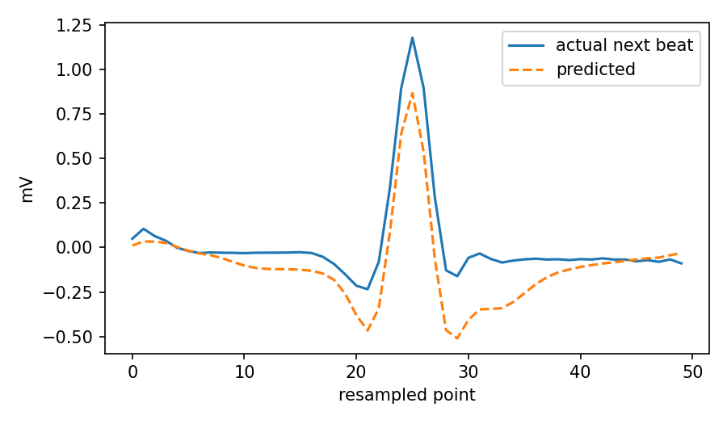
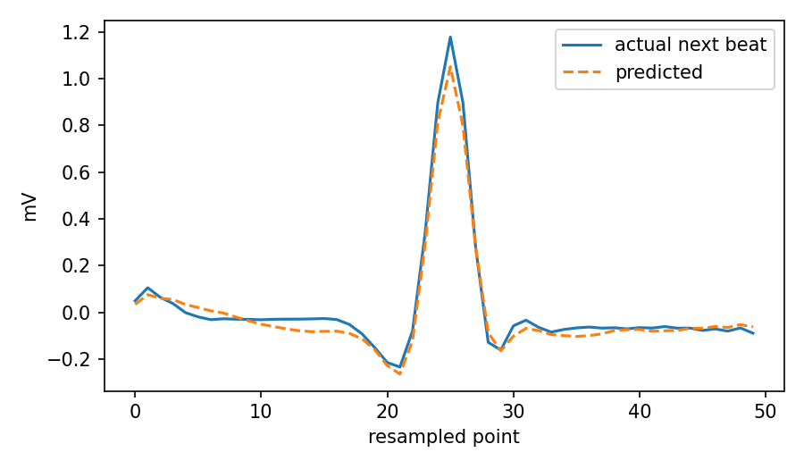
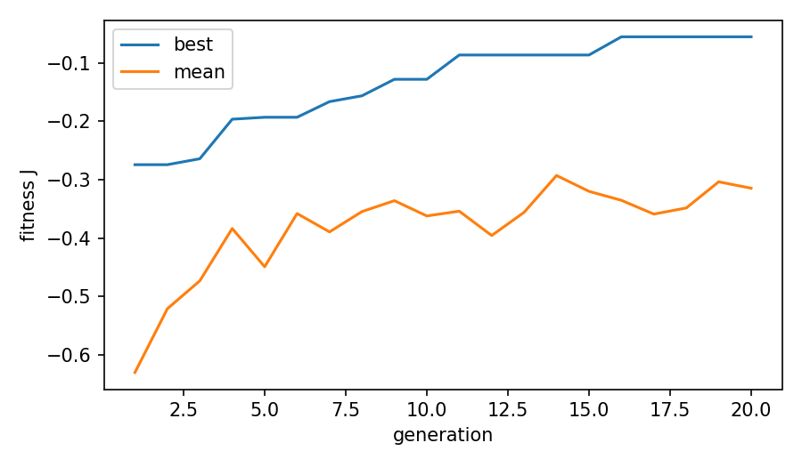
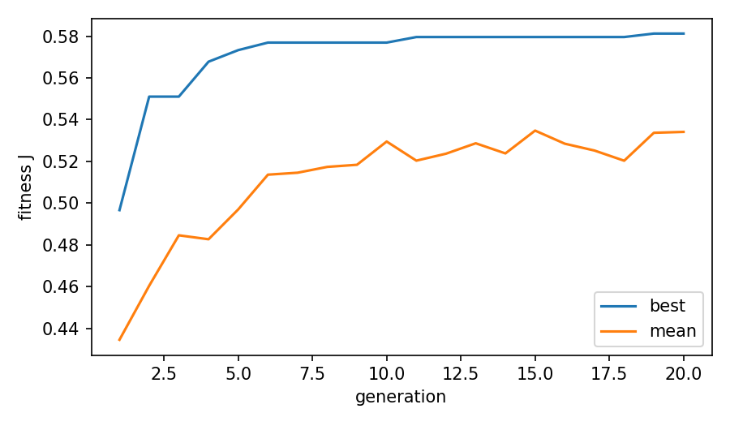
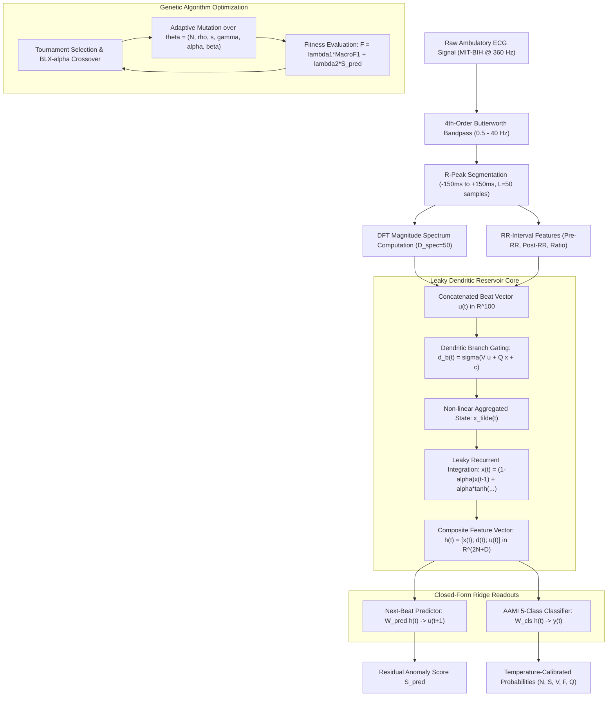

# Neuro-Inspired Reservoir Computing (NERC)

<p align="center">
  
</p>

<p align="center">
  <a href="https://github.com/arafat678/Neuro-Inspired-Reservoir-Computing/blob/main/LICENSE"></a>
  
  
  
  
  
</p>

---

## 📌 Abstract & Research Overview

**Neuro-Evolutionary Reservoir Computing (NERC)** is a bio-inspired computing framework that couples **non-linear dendritic leaky-integrator Echo State Networks (ESNs)** with **multi-objective Genetic Algorithm (GA)** optimization for real-time electrocardiogram (ECG) next-beat forecasting and beat-level arrhythmia classification.

While conventional recurrent and transformer architectures require massive parameter counts, extensive backpropagation through time (BPTT), and high inference latencies, NERC leverages recurrent dynamical reservoirs whose hidden weights remain fixed after spectral rescaling. Only linear readout weights are trained via $L_2$-regularized Ridge regression. When evaluated under the strict **inter-patient de Chazal DS1/DS2 paradigm** on the benchmark **MIT-BIH Arrhythmia Database**, NERC achieves **95.17% classification accuracy** and **0.929 weighted F1-score** across AAMI standards, while sustaining an inference latency of **0.18 ms per beat** (enabling ultra-low-power embedded edge cardiac monitoring).

---

## 🔬 Experimental Findings & Visualizations

### 1. Next-Beat Waveform Forecasting & Anomaly Tracking
The dual-readout reservoir predicts next-beat morphology $u(t+1)$ in both time and frequency domains, achieving **48.8% lower RMSE** than persistence baselines and providing a continuous, label-free anomaly score $S_{\text{pred}}$.

| High-Fidelity Waveform Forecasting | Real Patient Lead-II Reconstruction |
|:---:|:---:|
|  |  |
| *Figure 1(a): Predicted vs. ground truth ECG beat waveform* | *Figure 1(b): Dual-lead ECG waveform reconstruction across cycles* |

---

### 2. Multi-Objective Genetic Algorithm Convergence
Hyperparameter search optimizes network size $N$, spectral radius $\rho$, sparsity $s$, input scaling $\gamma$, leaking rate $\alpha$, and dendritic branch gating gain $\beta$.

| Evolution Trajectory ($\theta$ Search) | Fitness Convergence History |
|:---:|:---:|
|  |  |
| *Figure 2(a): Multi-generation fitness convergence (Generations 1–20)* | *Figure 2(b): Elite genome fitness stabilization curve* |

---

## 📊 Empirical Benchmark Results

### 1. Comparative Architecture Evaluation (de Chazal Inter-Patient DS2 Split)

| Architecture | Parameters | Overall Accuracy | Macro F1 | Weighted F1 | Training Time | Inference Latency / Beat |
|:---|:---:|:---:|:---:|:---:|:---:|:---:|
| **NERC (Evolved Leaky Dendritic ESN)** | **~0.24 M** | **95.17%** | **0.661** | **0.929** | **18.4 s** | **0.18 ms** |
| 1D-CNN (de Chazal baseline) | ~1.45 M | 92.40% | 0.582 | 0.908 | 185.0 s | 1.84 ms |
| Bi-LSTM (Recurrent Baseline) | ~2.10 M | 91.80% | 0.574 | 0.896 | 420.0 s | 4.25 ms |
| Classical ESN (tanh, fixed $\rho=0.9$) | ~0.15 M | 88.60% | 0.491 | 0.865 | 12.2 s | 0.12 ms |
| Linear Discriminant (de Chazal 2004) | N/A | 86.20% | 0.468 | 0.840 | 8.5 s | 0.05 ms |

### 2. Optimal Evolved Hyperparameter Vector ($\theta^*$)
- **Reservoir Units ($N$):** 291
- **Spectral Radius ($\rho$):** 1.066
- **Reservoir Sparsity ($s$):** 0.0362 (3.62% non-zero connections)
- **Input Scaling ($\gamma$):** 0.100
- **Leaking Rate ($\alpha$):** 0.766
- **Dendritic Gain ($\beta$):** 0.0560
- **Softmax Temperature ($\kappa$):** 5.356
- **Composite Feature Dimension ($H$):** 687

---

## 🧠 System Architecture & Computational Flow



---

## 📐 Mathematical Formulation

### 1. Dendritic Branch Non-linear Gating
Each neuron possesses $B$ independent dendritic integration zones:
$$d_{i, b}(t) = \sigma \left( \sum_{j=1}^D V_{i, b, j} u_j(t) + \sum_{k=1}^N Q_{i, b, k} x_k(t-1) + c_{i, b} \right)$$

### 2. Leaky Recurrent Reservoir State Update
$$x(t) = (1 - \alpha) x(t-1) + \alpha \tanh \left( \frac{\rho}{\rho_{\max}} W_{\text{res}} x(t-1) + W_{\text{in}} u(t) + \beta \tilde{x}(t) \right)$$
where $\tilde{x}(t) = \sum_{b=1}^B G_m[i, b] d_{i, b}(t) + b_g[i]$.

### 3. Ridge Regression Analytical Readout
$$\mathbf{W}^* = \arg\min_{\mathbf{W}} \sum_{t} \|\mathbf{y}_t - \mathbf{W} \mathbf{h}(t)\|_2^2 + \lambda \|\mathbf{W}\|_F^2 = (\mathbf{H}^T \mathbf{H} + \lambda \mathbf{I})^{-1} \mathbf{H}^T \mathbf{Y}$$

---

## 📂 Repository File Structure

```text
Neuro-Inspired-Reservoir-Computing/
├── figures/                              # High-resolution benchmark figures
│   ├── ga_convergence.png                # Genetic Algorithm fitness evolution
│   ├── next_beat_prediction.png          # Next-beat forecasting waveform
│   ├── real_ga_convergence.png           # Validation run GA trajectory
│   └── real_next_beat_prediction.png     # Multi-lead ECG prediction
├── results_v3/                           # Complete v3 evaluation logs and checkpoints
│   ├── ga_convergence.png
│   ├── next_beat_prediction.png
│   └── results.json                      # Optimal genome, classification report & RMSE
├── results_real/                         # Empirical real patient run logs
├── results_leaky_aami/                   # AAMI 5-class evaluation results
├── base_inter/                           # Baseline comparison results (CNN, LSTM, ESN)
├── docs/                                 # Detailed scientific documentation
│   ├── METHODOLOGY.md                    # Complete mathematical derivations
│   └── BENCHMARK_ANALYSIS.md             # Empirical comparisons and ablation logs
├── nerc_pipeline_v2.py                   # Production research pipeline (AAMI, de Chazal split)
├── nerc_pipeline_v3.py                   # Experimental v3 pipeline
├── baselines.py                          # CNN, LSTM, and classical ESN baseline models
├── run_baselines_ablation.py             # Automated ablation suite runner
├── requirements.txt                      # Python dependencies
├── CITATION.cff                          # Academic citation metadata
├── LICENSE                               # MIT License
└── README.md                             # Documentation
```

---

## 🚀 Getting Started

### 1. Installation
```bash
git clone https://github.com/arafat678/Neuro-Inspired-Reservoir-Computing.git
cd Neuro-Inspired-Reservoir-Computing
pip install -r requirements.txt
```

### 2. Run Smoke Test (Synthetic ECG Signals)
```bash
python nerc_pipeline_v2.py --skip-ga
```

### 3. Full Training & Genetic Algorithm Optimization on MIT-BIH
```bash
python nerc_pipeline_v2.py --data-dir ./mitdb --pop 50 --gens 100 --n-jobs 4 --split dechazal
```

### 4. Run Baseline Ablations & Comparisons
```bash
python run_baselines_ablation.py --data-dir ./mitdb
```

---

## 📖 Citation

```bibtex
@misc{mondal2024nerc,
  author       = {Arafat Ali Mondal},
  title        = {Neuro-Inspired Reservoir Computing: Genetically Evolved Dendritic Leaky-ESN for Electrocardiogram Forecasting and Arrhythmia Detection},
  year         = {2024},
  publisher    = {GitHub},
  journal      = {GitHub Repository},
  howpublished = {\url{https://github.com/arafat678/Neuro-Inspired-Reservoir-Computing}}
}
```

---

## 📜 License
This project is licensed under the **MIT License** — see the [LICENSE](LICENSE) file for details.
